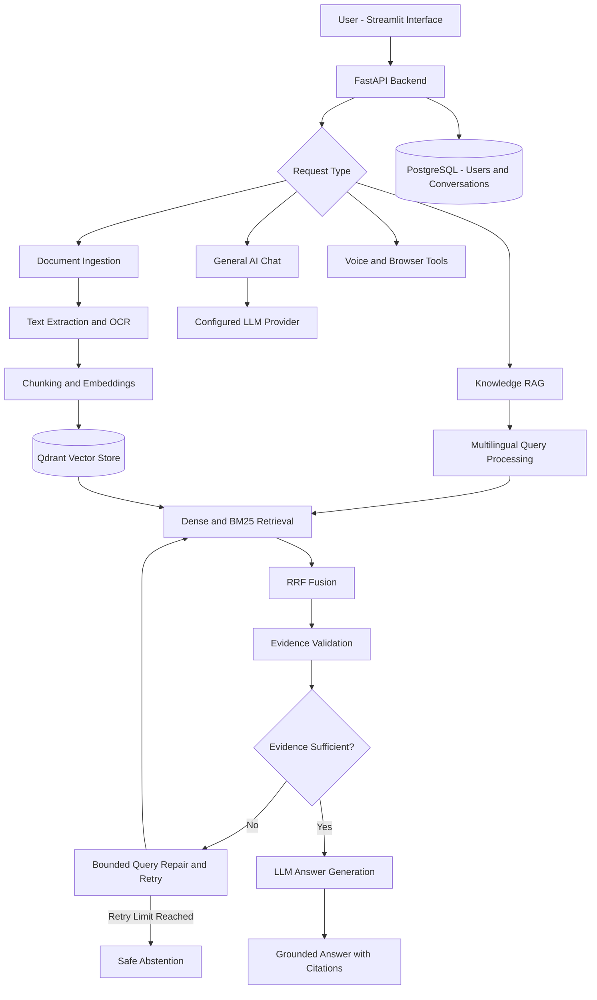

# Self-Healing Multilingual RAG & AI Assistant

**An end-to-end AI application for multilingual, document-grounded question answering with hybrid retrieval, self-healing workflows, voice interaction, and browser automation.**

**Tech Stack:** Python · FastAPI · Streamlit · PostgreSQL · Qdrant · FastEmbed · BM25 · Reciprocal Rank Fusion (RRF) · OpenAI API · Gemini API · Tesseract OCR · Playwright · Pytest

## Project Overview

Traditional Retrieval-Augmented Generation (RAG) applications can produce incomplete or unsupported answers when document retrieval fails, queries are ambiguous, or retrieved evidence is insufficient.

This project explores a **self-healing RAG architecture** that detects retrieval and evidence problems, attempts bounded query repair and retrieval retries, and abstains when sufficient supporting information is unavailable.

The application combines document-based question answering with a general AI chatbot, multilingual interactions, conversation persistence, voice features, OCR, and browser automation.

## Key Features

- **Multilingual AI:** English, Kannada, Hindi, and Telugu support with automatic language detection and manual selection.
- **Hybrid Retrieval:** Combines dense semantic retrieval and BM25 sparse retrieval using Qdrant and Reciprocal Rank Fusion.
- **Self-Healing RAG:** Retrieval failure detection, query repair, bounded retries, evidence checks, and safe abstention.
- **Source-Aware Answers:** Document-grounded responses with supporting citations.
- **Document Ingestion:** PDF, CSV, Excel, DOCX, TXT, Markdown, HTML, and supported web URLs.
- **OCR Support:** Tesseract-based extraction for scanned or text-sparse PDFs.
- **Voice Interaction:** Browser microphone input, speech-to-text, and text-to-speech support for four languages.
- **Authentication and Memory:** Email-based authentication and PostgreSQL conversation persistence.
- **LLM Integration:** Configurable language model providers including OpenAI and Gemini.
- **Browser Automation:** Playwright-powered Google search, URL opening, and YouTube search/playback with URL safety checks.
- **Testing and Security:** Automated tests, offline evaluation utilities, security headers, request-size protection, and browser URL validation.

## System Architecture



## How Self-Healing Retrieval Works

1. The user submits a document-related question.
2. The system processes the query and retrieves relevant document chunks.
3. Dense and sparse retrieval results are combined using RRF.
4. Retrieved evidence is evaluated for relevance and sufficiency.
5. If the evidence is inadequate, the system attempts query repair and bounded retrieval retries.
6. If sufficient evidence is found, the LLM generates a source-grounded answer.
7. If evidence remains insufficient, the system abstains instead of presenting unsupported information as fact.

The system is designed to reduce unsupported answers; it does not guarantee that hallucinations are impossible.

## Technology Stack

| Component | Technology |
|---|---|
| Programming language | Python |
| Backend API | FastAPI, Uvicorn |
| Frontend | Streamlit |
| Relational database | PostgreSQL |
| Vector database | Qdrant |
| Embeddings | Multilingual embedding model / FastEmbed |
| Sparse retrieval | BM25 |
| Retrieval fusion | Reciprocal Rank Fusion |
| LLM integration | OpenAI API, Gemini API |
| OCR | Tesseract |
| Browser automation | Playwright |
| Testing | Pytest |
| Evaluation | Custom offline RAG evaluation harness |

## Project Structure

```text
Multi_RAG/
├── backend/
│   └── app/
│       ├── auth/
│       ├── browser/
│       ├── conversations/
│       ├── core/
│       ├── db/
│       ├── documents/
│       ├── llm/
│       ├── rag/
│       ├── security/
│       ├── voice/
│       └── main.py
├── frontend/
│   ├── app.py
│   └── api_client.py
├── evaluation/
│   └── rag_eval.py
├── tests/
├── requirements.txt
├── .env.example
├── DEPLOYMENT.md
├── start_backend.bat
└── start_frontend.bat
```

## Local Installation

### Prerequisites

- Python and pip
- PostgreSQL
- Git
- Tesseract OCR for scanned documents
- Google Chrome for supported browser automation
- At least one configured LLM provider

### 1. Clone the repository

```bat
git clone https://github.com/KarunkumarAI/multilingual-rag.git
cd multilingual-rag
```

### 2. Create a virtual environment

```bat
py -3.11 -m venv venv
venv\Scripts\activate
```

### 3. Install dependencies

```bat
pip install -r requirements.txt
```

### 4. Configure environment variables

```bat
copy .env.example .env
```

Edit `.env` and supply your PostgreSQL connection URL, JWT secret, and the API keys required by your selected LLM provider.

The backend configuration uses `RAG_DATABASE_URL` and `RAG_JWT_SECRET`.

Never commit `.env`, production credentials, or personal document data.

### 5. Initialize PostgreSQL

Create the database and database user required by your configuration, then run:

```bat
python -m backend.app.db.init_db
```

### 6. Start the backend

```bat
python -m uvicorn backend.app.main:app --reload --port 8000
```

Backend API documentation:

http://localhost:8000/docs

### 7. Start the frontend

Open another CMD window, activate the virtual environment, and run:

```bat
python -m streamlit run frontend/app.py
```

Frontend:

http://localhost:8501

## Multilingual Retrieval

The application supports:

| Language | Code |
|---|---|
| English | `en` |
| Kannada | `kn` |
| Hindi | `hi` |
| Telugu | `te` |

Automatic language detection and manual language selection are supported.

When changing the embedding model or Qdrant collection schema, previously ingested documents may need to be reprocessed to ensure compatible vector dimensions and representations.

## Voice and OCR

Voice capabilities include browser microphone capture, speech-to-text, and text-to-speech endpoints.

For OCR on Windows, install Tesseract with the `eng`, `kan`, `hin`, and `tel` language data.

Verify installation:

```bat
tesseract --version
tesseract --list-langs
```

Normal PDF text extraction is attempted before OCR fallback.

## Browser and YouTube Automation

The application includes authenticated browser actions powered by Playwright.

Supported actions include opening permitted public URLs, Google searches, YouTube searches, first-result playback, and pause/resume controls.

Browser automation uses an isolated Chrome profile under `data/browser_profile`. URL validation blocks localhost, private, link-local, and reserved destinations.

## Testing and Evaluation

Run automated tests:

```bat
pytest -q
```

Run the offline evaluation harness:

```bat
python -m evaluation.rag_eval
```

The evaluation harness can run without an LLM API key. Generating production RAG answers requires a configured LLM provider.

Tests cover areas including multilingual language handling, retrieval evidence checks, and browser URL security.

### Suggested Manual Validation

- Upload a document and ask grounded questions.
- Repeat questions in all four supported languages.
- Ask questions not supported by the document and check abstention behavior.
- Verify that answers include appropriate citations.
- Test authentication and conversation persistence.
- Test OCR with scanned documents.
- Test voice input/output and browser automation.

## Deployment Status

The project currently supports **local execution using FastAPI, Streamlit, and PostgreSQL**.

Cloud hosting, production monitoring, and externally accessible deployment remain future improvements. See `DEPLOYMENT.md` for additional deployment notes.

## Future Improvements

- Cloud deployment and production observability
- Expanded multilingual retrieval evaluation
- Automated retrieval-quality and citation metrics
- Performance and latency benchmarking
- Improved query-repair strategies
- CI/CD integration

## Repository

GitHub: https://github.com/KarunkumarAI/multilingual-rag

**Project focus:** Retrieval-Augmented Generation, multilingual NLP, evidence-grounded LLM applications, retrieval reliability, and AI backend engineering.

## Application Screenshots

### Multilingual Document Question Answering


### Persistent Conversation History


### Voice-Enabled Knowledge RAG
